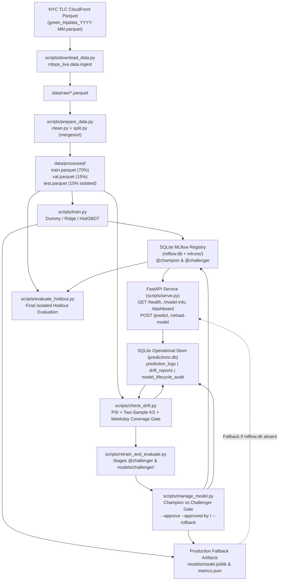

# ML-Ops-Live

A production-style, local-first MLOps platform built around a real public dataset:
**NYC TLC Green Taxi trip records**, used to predict **trip duration (`duration_minutes`)** at ride-request time.

> **Current Status:** Phases 1–7 implemented and locally verified on Windows 11 / Python 3.11.9 (`54 passed` automated tests, `ruff check` and `ruff format --check` clean).

---

## System Architecture



---

## Implementation & Verification Status Matrix

| Capability | Implementation Status | Verification Scope |
| :--- | :--- | :--- |
| **Data Ingestion, Cleaning & Chronological Splitting** | Implemented (`src/mlops_live/data/`, `scripts/download_data.py`, `scripts/prepare_data.py`) | **Locally verified** on real Jan 2024 NYC Green Taxi data (`56,551` raw rows $\rightarrow$ `52,529` cleaned rows) and covered by unit/CLI tests. |
| **Baseline & Candidate Model Training** | Implemented (`src/mlops_live/models/`, `scripts/train.py`) | **Locally verified** on real `train.parquet` (`36,770` rows) and `val.parquet` (`7,879` rows). |
| **SQLite MLflow Tracking & Model Registry** | Implemented (`src/mlops_live/tracking/mlflow_tracker.py`) | **Locally verified** with `mlflow.db` + `mlruns/` (`@champion` = `v2`, `@challenger` = `v1`). |
| **FastAPI Serving, SQLite Logging & HTML Dashboard** | Implemented (`src/mlops_live/serving/`, `scripts/serve.py`) | **Locally verified** (`GET /health`, `GET /model-info`, `POST /predict`, `POST /reload-model`, `GET /dashboard`, `GET /api/dashboard-summary`) with HTML XSS escaping (`html.escape`). |
| **PSI & Kolmogorov–Smirnov Drift Monitoring** | Implemented (`src/mlops_live/monitoring/drift.py`, `scripts/check_drift.py`) | **Locally verified** with weekday-coverage safeguard (`evaluation_status="insufficient_data"` when `< 7` weekdays or `< 5` samples/weekday). |
| **Retraining, Human Approval Gate & Rollback** | Implemented (`src/mlops_live/lifecycle/workflow.py`, `scripts/retrain_and_evaluate.py`, `scripts/manage_model.py`) | **Locally verified** via end-to-end automated tests on temporary registries/artifacts and read/eval checks on `mlflow.db`. |
| **Isolated Holdout Evaluation (`test.parquet`)** | Implemented (`scripts/evaluate_holdout.py`) | **Locally verified** on untouched `data/processed/test.parquet` (`7,880` rows). |
| **Concurrent Load & Latency Testing** | Implemented (`scripts/load_test.py`: `--mode in_process` and `--mode http` / `--spawn-server`) | **Locally verified** in both in-process `TestClient` mode (`reports/generated/load_test_report.json`) and live localhost TCP HTTP Uvicorn mode (`reports/generated/http_load_test_report.json`). |
| **GitHub Actions CI Workflow** | Implemented (`.github/workflows/ci.yml`) | **Configured locally, unverified on GitHub** (no Git remote is configured yet; all CI steps pass locally). |

---

## Verified Benchmark Results (January 2024 NYC Green Taxi Dataset)

### 1. Dataset Split Summary (`data/raw/green_tripdata_2024-01.parquet`)
- **Raw rows:** `56,551` $\rightarrow$ **Cleaned rows:** `52,529` (`92.89%` retained after filtering `1.0 <= duration_minutes <= 60.0`, `0.01 <= trip_distance <= 100.0`, and valid pickup/dropoff zone IDs).
- **Features (strictly leakage-safe at pickup):** `PULocationID`, `DOLocationID`, `trip_distance`, `passenger_count`, `pickup_hour`, `pickup_day_of_week`.
- **Chronological partitions (sorted via stable `mergesort`):**
  - `train.parquet`: `36,770` rows (`2023-12-31 14:38:47` $\rightarrow$ `2024-01-23 07:46:22`)
  - `val.parquet`: `7,879` rows (`2024-01-23 07:46:37` $\rightarrow$ `2024-01-27 13:37:47`)
  - `test.parquet`: `7,880` rows (`2024-01-27 13:40:09` $\rightarrow$ `2024-01-31 23:57:29`)

### 2. Validation & Isolated Holdout Test Metrics (`models/metrics.json` & `reports/generated/holdout_test_metrics.json`)

| Model | Registry Alias | Train MAE (min) | Val MAE (min) | Val RMSE (min) | Val $R^2$ | Holdout Test MAE (min) | Holdout Test RMSE (min) | Holdout Test $R^2$ | Holdout Abs Error P50 / P90 / P95 (min) |
| :--- | :--- | ---: | ---: | ---: | ---: | ---: | ---: | ---: | ---: |
| `dummy_median` | — | `6.0312` | `6.6407` | `9.7804` | `-0.0975` | — | — | — | — |
| `ridge_baseline` | `@challenger` (`v1`) | `3.1373` | `3.4161` | `5.2064` | `0.6890` | `3.1997` | `4.8099` | `0.7042` | `2.22` / `6.93` / `9.64` |
| **`hist_gbdt_candidate`** | **`@champion` (`v2`)** | **`2.4961`** | **`2.9183`** | **`4.7223`** | **`0.7441`** | **`2.7498`** | **`4.3525`** | **`0.7578`** | **`1.68` / `6.28` / `9.00`** |

- **Candidate vs. Baseline Gain:**
  - **Validation (`7,879` rows):** `-0.4978` min MAE (`-14.57%`), `-0.4842` min RMSE (`-9.30%`), `+0.0552` $R^2$.
  - **Isolated Holdout Test (`7,880` rows):** `-0.4499` min MAE (`-14.06%`), `-0.4574` min RMSE (`-9.51%`), `+0.0536` $R^2$.

### 3. Concurrent Load Testing (`scripts/load_test.py`)

`scripts/load_test.py` supports two distinct execution modes:

1. **In-Process `TestClient` Microbenchmark (`--mode in_process`, default):**
   - Executes concurrent requests in-process using Starlette/FastAPI `TestClient` and a `ThreadPoolExecutor` (without an external TCP socket).
   - Writes to `reports/generated/load_test_report.json` by default.
2. **Real-HTTP Localhost Load Testing (`--mode http`, `--base-url`, or `--spawn-server`):**
   - Sends concurrent TCP HTTP requests (`POST /predict`) using `requests.Session` with automatic retries disabled (`HTTPAdapter(max_retries=0)`) against a live localhost Uvicorn server (`127.0.0.1` or `localhost` only).
   - Records client-observed round-trip latency (`client_latency_ms`) and server-reported inference latency (`server_inference_latency_ms`) separately, plus structured failure counts (`http_errors`, `timeouts`, `connection_errors`, `other_errors`).
   - **Database Isolation (`--spawn-server`):** When spawning a managed Uvicorn child server, prediction logs are directed to a temporary SQLite database (`temp_predictions.db` in an isolated temporary directory) that is automatically removed after the child server stops. The operational `predictions.db` is never modified.
   - **Report Non-Overwrite Protection:** Real-HTTP mode refuses to overwrite `reports/generated/load_test_report.json` or any existing report file. When `--output-json` is omitted, it writes to a unique UTC-timestamped path `reports/generated/http_load_test_report_<YYYYMMDDTHHMMSSZ>.json`.
   - **Methodology Caveat (`local_uvicorn_localhost_tcp_http`):** Results are measured over localhost loopback TCP on a single Windows machine and depend on local CPU load, model warm-up, concurrency, and OS thread scheduling; they do not establish cloud or production-scale capacity.

#### Verified Real-HTTP Localhost Uvicorn Benchmark (`reports/generated/http_load_test_report.json`)

| Methodology | Target | Concurrency | Total Requests | Error Rate | Throughput (`req/s`) | Server Inference P50 / P95 / P99 (`ms`) | Client HTTP Round-Trip P50 / P95 / P99 (`ms`) | SLA Gate (`P95 <= 500 ms`) |
| :--- | :--- | ---: | ---: | ---: | ---: | ---: | ---: | :--- |
| `local_uvicorn_localhost_tcp_http` | `http://127.0.0.1:8010/predict` (`hist_gbdt_candidate` `v2` `@champion`) | `4` threads | `50` | `0.0%` (`50/50`) | `24.72` | `112.67` / `255.01` / `262.29` | `145.99` / `292.38` / `323.96` | **PASSED (`true`)** |

#### Verified In-Process Benchmark (`reports/generated/load_test_report.json`)

| Concurrency | Total Requests | Error Rate | Throughput (`req/s`) | Server Inference P50 / P95 (`ms`) | Client Round-Trip P50 / P95 (`ms`) | SLA Gate (`P95 <= 500 ms`) |
| ---: | ---: | ---: | ---: | ---: | ---: | :--- |
| `4` threads | `100` | `0.0%` | `16.04` | `169.16` / `395.03` | `215.82` / `438.44` | **PASSED (`true`)** |
| `8` threads | `100` | `0.0%` | `19.96` | `304.24` / `493.00` | `373.12` / `565.12` | **FAILED (`false`, CPU thread contention on 2C/4T laptop)** |

---

## Governance, Artifact Safety & Drift Reliability Design

### 1. Pre-Approval Model Artifact Protection
- **Bootstrap vs. Challenger Staging:** When no `@champion` exists in `mlflow.db` (initial training) or when `--promote-winner` is explicitly supplied, `run_baseline_vs_candidate_training()` writes the winning model to `models/model.joblib` and `models/metrics.json`.
- **Challenger Isolation During Retraining:** When an incumbent `@champion` already exists in `mlflow.db` and `promote_winner=False` (the default for `scripts/retrain_and_evaluate.py` and `scripts/train.py --force`), the newly trained winner is registered as `@challenger` in MLflow and its local artifacts are written to `models/challenger/model.joblib` and `models/challenger/metrics.json`. The active production fallback files (`models/model.joblib` and `models/metrics.json`) remain untouched until human approval.
- **Transactional Promotion & Rollback:** `approve_and_promote_challenger()` and `rollback_champion_model()` verify the quantitative evaluation gate first, load and validate the target pipeline from MLflow before mutating aliases, and update `models/model.joblib` + `models/metrics.json` using two-phase `.tmp` staging and `.bak` backup rollback. If either the gate check or artifact write fails, both the MLflow `@champion` alias and local production artifacts remain intact.

### 2. Dashboard XSS Escaping
- `render_dashboard_html()` in `src/mlops_live/serving/dashboard.py` escapes all dynamic values sourced from SQLite or model metadata (`actor`, `notes`, `event_type`, `model_name`, `model_version`, `current_source`, `drifted_columns`, `request_id`) using `html.escape(..., quote=True)`. Raw unescaped values remain available via the JSON endpoint `GET /api/dashboard-summary`.

### 3. Weekday Coverage Safeguard in Drift Monitoring
- **Why calendar features require coverage checks:** `pickup_day_of_week` (`0=Monday .. 6=Sunday`) is a 7-day cyclic calendar feature. Comparing a multi-week reference split (`train.parquet`, 23 days covering all 7 weekdays) against a chronological slice shorter than a full week (such as `val.parquet`, which spans 4.2 days from Tuesday to Saturday and has zero Sunday or Monday trips) produces a high raw PSI (`2.03`) solely because two weekdays are unobserved in the window.
- **Principled safeguard (`check_weekday_coverage`):** Before flagging drift on `pickup_day_of_week`, `evaluate_column_drift()` verifies that:
  1. If `lpep_pickup_datetime` is present on the comparison DataFrame, the window spans at least 7 calendar days (`>= 6.0` elapsed 24-hour periods).
  2. Every weekday present in the reference dataset is observed in the comparison window.
  3. Every expected weekday has at least `min_weekday_count = 5` observations (Cochran's minimum cell support for categorical goodness-of-fit).
- **Explicit `insufficient_data` reporting:** When weekday coverage is inadequate, `pickup_day_of_week` is neither silently marked as `"none"` (passing) nor added to `drifted_columns`. Instead, its column report sets `evaluation_status = "insufficient_data"`, `psi_severity = "insufficient_data"`, `drift_detected = False`, and records a human-readable `status_reason`, while the top-level `DriftReport` lists `"pickup_day_of_week"` in `insufficient_data_columns`. When all 7 weekdays are adequately covered, genuine weekday distribution shifts are flagged normally.
- **Remaining Drift Limitations:** Current monitoring evaluates univariate feature and prediction distributions (PSI and two-sample KS) and does not yet ingest delayed ground-truth labels (`actual_duration_minutes`) to compute realized online MAE/RMSE on production traffic.

---

## Reproducible Windows PowerShell Runbook

All commands below use the existing virtual environment (`.\.venv\Scripts\python.exe`) from `D:\Projects\mlops-live`.

### 1. Environment Setup
```powershell
python -m venv .venv
.\.venv\Scripts\python.exe -m pip install --upgrade pip
.\.venv\Scripts\python.exe -m pip install -r requirements-dev.txt
.\.venv\Scripts\python.exe -m pip install -e . --no-deps
```
*(For an exact transitive lock, install `-r requirements-lock.txt`.)*

### 2. End-to-End Pipeline Execution
```powershell
# Step 1: Ingest raw monthly TLC Green Taxi Parquet data (skips download if already valid)
.\.venv\Scripts\python.exe scripts\download_data.py --year 2024 --month 1

# Step 2: Clean records, validate chronological boundaries, and write train/val/test splits
.\.venv\Scripts\python.exe scripts\prepare_data.py --input-file data/raw/green_tripdata_2024-01.parquet --output-dir data/processed

# Step 3: Train Dummy, Ridge, and HistGBDT models, log to MLflow (mlflow.db), and register @champion/@challenger
.\.venv\Scripts\python.exe scripts\train.py --train-file data/processed/train.parquet --val-file data/processed/val.parquet --output-dir models

# Step 4: Start the FastAPI prediction service & monitoring dashboard
.\.venv\Scripts\python.exe scripts\serve.py --host 127.0.0.1 --port 8000
# -> Dashboard HTML: http://127.0.0.1:8000/dashboard
# -> Dashboard JSON: http://127.0.0.1:8000/api/dashboard-summary

# Step 5: Run PSI & KS drift detection (against a Parquet batch or live SQLite predictions.db)
.\.venv\Scripts\python.exe scripts\check_drift.py --reference-file data/processed/train.parquet --current-file data/processed/val.parquet
.\.venv\Scripts\python.exe scripts\check_drift.py --use-predictions-db --predictions-db predictions.db

# Step 6: Run automated retraining (stages candidate in MLflow @challenger and models/challenger/)
# (Optional: pass --drift-report <path> and --eval-report <path> to write reports to custom paths)
.\.venv\Scripts\python.exe scripts\retrain_and_evaluate.py --only-if-drifted

# Step 7: Inspect registry status, evaluate @champion vs @challenger, approve promotion, or roll back
# (Optional: pass --eval-report <path> with --evaluate to write the comparison JSON to a custom path)
.\.venv\Scripts\python.exe scripts\manage_model.py --status
.\.venv\Scripts\python.exe scripts\manage_model.py --evaluate --eval-file data/processed/val.parquet
.\.venv\Scripts\python.exe scripts\manage_model.py --approve --approved-by najahaja
.\.venv\Scripts\python.exe scripts\manage_model.py --rollback-previous --approved-by najahaja --reason "rollback_check"
.\.venv\Scripts\python.exe scripts\manage_model.py --rollback-to-version 2 --approved-by najahaja

# Step 8: Run isolated holdout evaluation on test.parquet
.\.venv\Scripts\python.exe scripts\evaluate_holdout.py --test-file data/processed/test.parquet

# Step 9a: Run in-process TestClient microbenchmark (default mode)
.\.venv\Scripts\python.exe scripts\load_test.py --num-requests 100 --concurrency 4

# Step 9b: Run real-HTTP load test with a managed local Uvicorn server (isolated temp predictions DB)
.\.venv\Scripts\python.exe scripts\load_test.py --spawn-server --host 127.0.0.1 --port 8010 --num-requests 50 --concurrency 4 --timeout 5.0

# Step 9c: Or start/test/stop a local Uvicorn server manually across two PowerShell terminals:
# Terminal 1 (start server with an isolated predictions DB; press Ctrl+C when finished):
.\.venv\Scripts\python.exe scripts\serve.py --host 127.0.0.1 --port 8010 --predictions-db temp_http_predictions.db
# Terminal 2 (run real-HTTP load test against the running localhost server):
.\.venv\Scripts\python.exe scripts\load_test.py --mode http --base-url http://127.0.0.1:8010 --num-requests 50 --concurrency 4 --timeout 5.0
```

### 3. Quality, Security & Regression Checks
```powershell
.\.venv\Scripts\python.exe -m pip check
.\.venv\Scripts\python.exe -m ruff check .
.\.venv\Scripts\python.exe -m ruff format --check .
.\.venv\Scripts\python.exe -m pytest
```

---

## Data Source

NYC Taxi & Limousine Commission (TLC) Trip Record Data:
https://www.nyc.gov/site/tlc/about/tlc-trip-record-data.page
